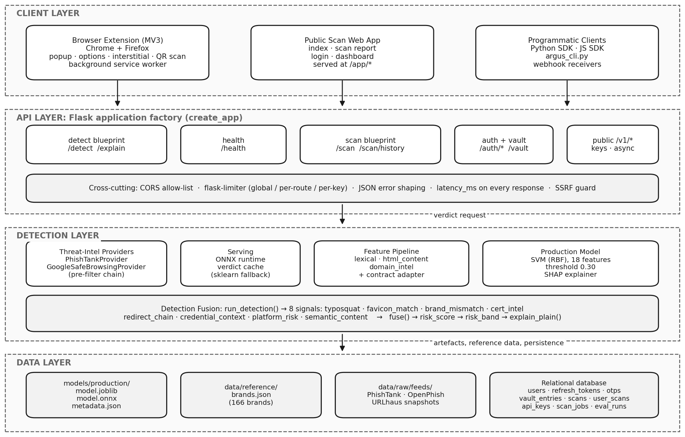
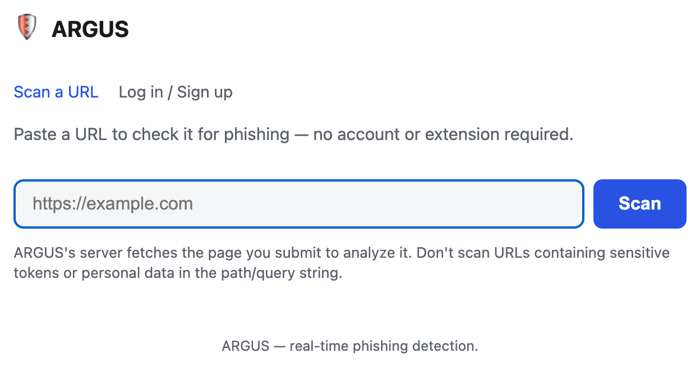
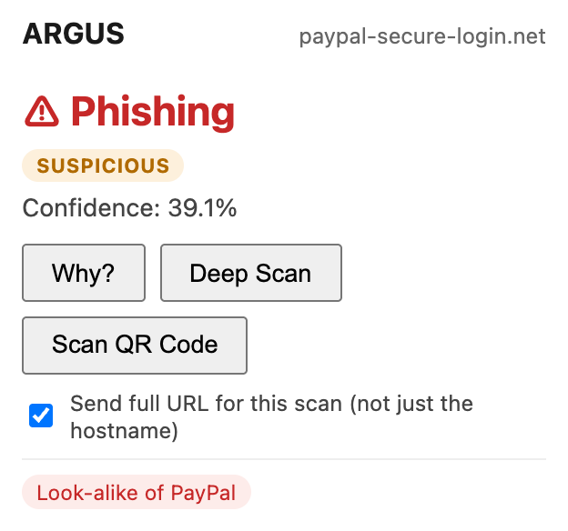
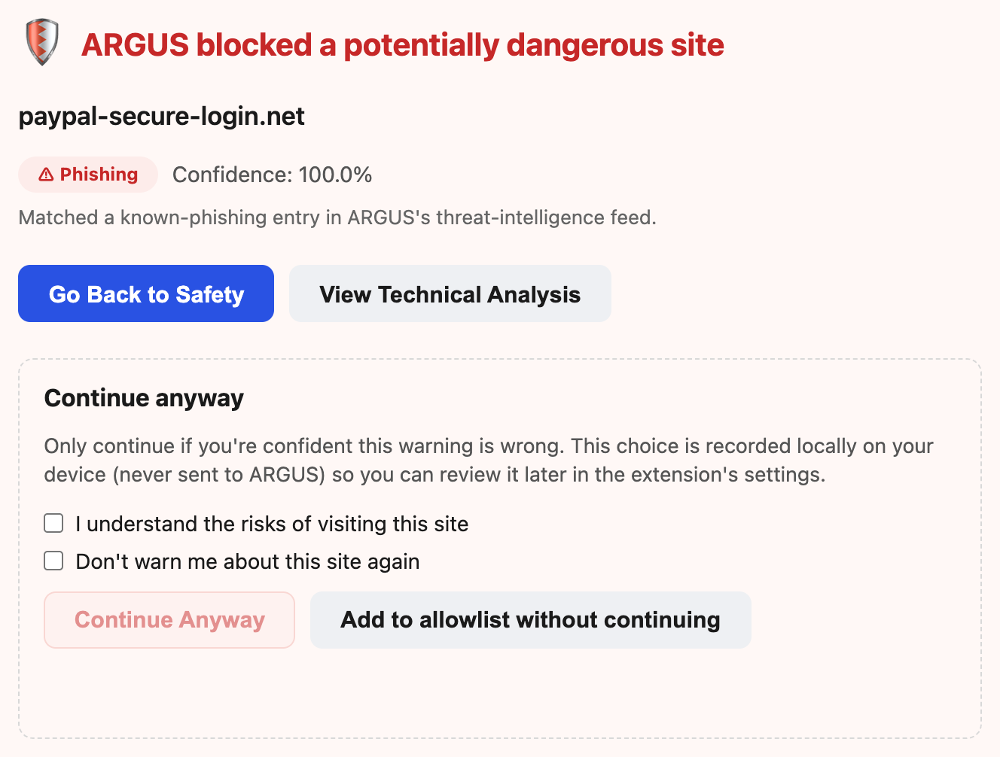
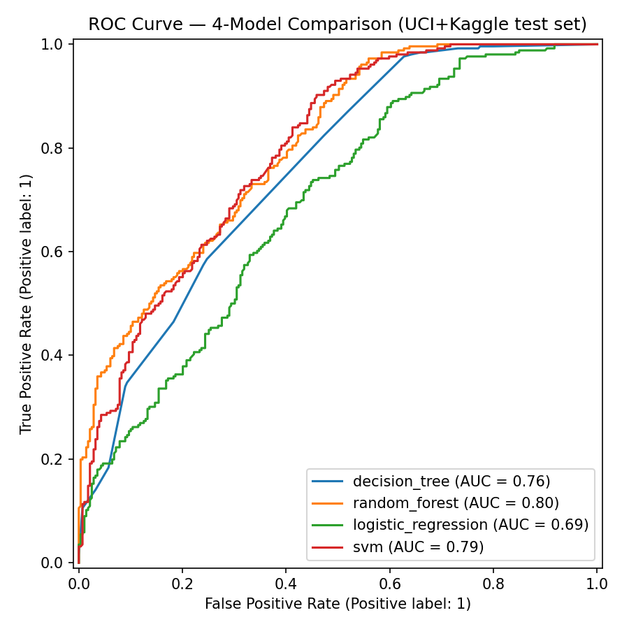
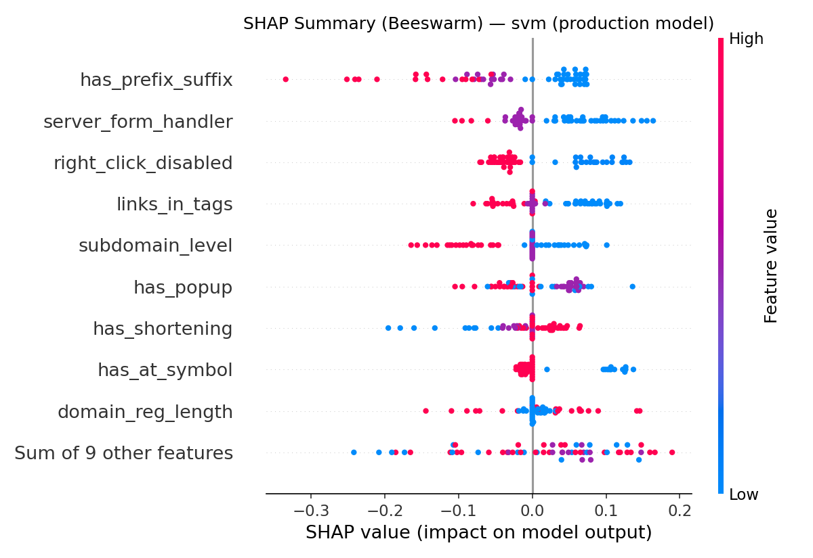

# ARGUS

[](https://github.com/raul-6j/argus/actions/workflows/ci.yml)
[](LICENSE)
[](https://www.python.org/)

**A**utomated **R**eal-time **G**uard against **U**RL-based **S**cams — a real-time phishing website detection system using machine learning.

Academic final-year project and production-quality portfolio piece.

## Overview

ARGUS extracts features from a URL (lexical, HTML, WHOIS, and network signals),
runs them through a trained ML classifier, and returns a phishing/benign
verdict with an explanation — exposed over a Flask API for real-time use.



Three surfaces share one detection core: a public web app, an MV3 browser
extension (Chrome and Firefox from one source tree), and a versioned `/v1`
developer API with a Python CLI and SDK.

| Web app | Extension popup | Pre-navigation block |
|---|---|---|
|  |  |  |

## Stack

| Layer    | Technology                          |
|----------|-------------------------------------|
| Language | Python 3.10+                        |
| ML       | scikit-learn (Decision Tree, Random Forest, Logistic Regression, SVM), SHAP |
| API      | Flask 3.0 (Blueprints)              |
| DB       | SQLite (dev), PostgreSQL (prod)     |
| Testing  | pytest + coverage                   |
| Deploy   | Docker + Azure Container Apps       |

## Results

### Model selection

Four classifiers were compared on a held-out test set touched exactly once
(535 rows, UCI + Kaggle merged under an 18-feature contract). Selection rule:
max F1, ROC-AUC as tie-break.

| Model | F1 | ROC-AUC | Precision | Recall |
|---|---:|---:|---:|---:|
| **SVM** (selected) | **0.725** | 0.793 | 0.647 | 0.824 |
| Decision Tree | 0.715 | 0.756 | 0.606 | 0.871 |
| Random Forest | 0.710 | 0.800 | 0.639 | 0.797 |
| Logistic Regression | 0.621 | 0.691 | 0.609 | 0.633 |

| ROC comparison | SHAP feature attribution |
|---|---|
|  |  |

### The finding that shaped the system

Benchmark performance did not transfer. The drift harness
(`scripts/eval_drift.py`) samples 200 URLs from a live phishing feed, scores
whatever is still reachable, and scores a benign control set alongside it.
Every run to date:

| Run | Feed | Reachable | Model only | Model + fusion | FP rate | typosquat hits |
|---|---|---:|---:|---:|---:|---:|
| 16 Jul 2026 | Jul | 129 | 0.023 | 0.752 | 0.556 | 94 |
| 16 Jul 2026 | Jul | 129 | 0.023 | 0.752 | 0.538 | 94 |
| 23 Jul 2026 | Jul | 117 | 0.000 | 0.795 | 0.304 | 92 |
| 7 Aug 2026 | Jul | 103 | 0.000 | 0.883 | 0.130 | 91 |
| 19 Aug 2026 | **Aug** | 44 | 0.023 | **0.045** | 0.087 | 0 |
| 19 Aug 2026 | Jul | 98 | 0.000 | **0.929** | 0.042 | 91 |

The last two rows are the same code against different feed snapshots, and
the 4th and 6th are the same feed against different code. Read together they
separate the two effects cleanly:

* **Code, held feed constant** (7 Aug → 19 Aug on the July snapshot): recall
  0.883 → 0.929, false positives 0.130 → 0.042. Both improved.
* **Feed, held code constant** (19 Aug, July vs August snapshot): recall
  0.929 → 0.045. Nothing about the system changed between those two numbers.

Two things are stable across every run; one is not.

**Stable — the model does not transfer.** Model-only recall never exceeds
0.023 on live URLs, against 0.725 F1 on the held-out benchmark. Benchmark
features are quantised to `{-1, 0, 1}` and 11 of 18 are unmeasurable on a
live page, so the classifier receives almost no real signal at inference
time. This is the project's central finding.

**Stable — false positives fell steadily**, 0.556 to 0.042 on the same feed,
as fusion moved from a weighted mean to noisy-OR and signals gained
corroboration requirements.

**Not stable — fused recall tracks the threat mix.** Five runs against the
July snapshot each saw ~91–94 typosquats of catalogued brands and caught
nearly all of them. The August snapshot contains none: typosquat fires zero
times and 43 of 44 reachable URLs trigger no signal at all. The controlled
comparison above rules out any code change as the cause.

So the defensible claim is narrower than any single row above:

> ARGUS detects **brand-impersonation** phishing well — typosquats, favicon
> and logo matches, certificate mismatches, measured against a 166-brand
> reference — and detects phishing that impersonates nothing at roughly the
> rate the underlying classifier does, which is near zero. Measured "recall"
> is therefore largely a function of how much of the sampled threat mix is
> brand impersonation.

That also names the next step: recall on live feeds is bounded by
brand-reference coverage, so expanding the 166-brand catalogue is worth more
than further model tuning.

**Limitations.** Each run is one sample of 44–129 reachable URLs against a
30-URL control set — wide confidence intervals, a single feed source, and
reachability between 22% and 64% because phishing URLs die quickly. No single
run should be quoted as *the* recall figure.

## Project Structure

```
argus/
  src/
    features/   # Feature extraction modules
    models/     # Model training, evaluation, serialization
    api/        # Flask API (Blueprints: /detect, /health, /explain)
    data/       # Dataset loading and preprocessing
    utils/      # Logging, config, validators
  tests/        # pytest suite (mirrors src/)
  scripts/      # train.py, evaluate.py, data_prep.py
  configs/      # model_config.yaml, feature_config.yaml, api_config.yaml, ...
  models/       # Serialized models (git-ignored, Iron Law #5)
  notebooks/    # Jupyter notebooks for EDA
  migrations/   # Alembic schema migrations
  extension/    # MV3 browser extension (Chrome + Firefox, one source tree)
  webapp/       # Public "scan a URL" web app, served at /app/*
  sdk/          # Python + JS clients for the /v1 developer API, plus the CLI
```

> Architecture notes, the decision log, experiment records and the written
> report are kept outside this repository.

## Setup

```bash
# 1. Create and activate a virtual environment
python -m venv venv
source venv/bin/activate          # Windows: venv\Scripts\activate

# 2. Install dependencies
pip install -r requirements.txt

# 3. tldextract needs its own writable cache dir
export TLDEXTRACT_CACHE=/tmp/tldextract_cache
```

## Usage

```bash
# A SECRET_KEY is mandatory — the app fails closed without one, by design
export SECRET_KEY=$(python -c "import secrets; print(secrets.token_urlsafe(32))")

# Train and evaluate first: the API refuses to start without a model
python scripts/data_prep.py
python scripts/train.py    --config configs/model_config.yaml
python scripts/evaluate.py --config configs/model_config.yaml   # writes models/production/

# Run the API locally
python -m flask --app src/api/app run

# Health check
curl http://127.0.0.1:5000/health

# Run the test suite with coverage
pytest tests/ -v --cov=src --cov-report=html
```

> **Model artefacts are not in this repository.** Serialized models are
> git-ignored on purpose, as are the dataset splits. Until `train.py` and
> `evaluate.py` have been run, `create_app()` will refuse to start and roughly
> a third of the test suite skips itself.

## Database migrations

Schema is managed with Alembic. `create_all()` creates missing *tables* but
never alters an existing one, so a schema change needs a migration or it
silently does nothing and fails later at query time.

```bash
alembic upgrade head      # apply pending migrations
alembic current           # what revision this database is at
alembic upgrade head --sql   # print the SQL without connecting

# After changing a model: register it in src/api/metadata.py FIRST — an
# unregistered model autogenerates as a DROP TABLE — then:
alembic revision --autogenerate -m "describe the change"
```

Always read a generated migration before applying it: autogenerate cannot
detect renames (it emits drop + add, losing data) or data backfills.

## Deployment

```bash
# Production server (never Flask's built-in server)
gunicorn --config gunicorn.conf.py wsgi:application

# Container
docker build -t argus:latest .
docker run --rm -p 5000:5000 -e SECRET_KEY="$(openssl rand -base64 32)" argus:latest
```

Three things to get right in a real deployment:

- **`trusted_proxy_count`** (`configs/api_config.yaml`) must equal the exact
  number of reverse proxies in front of the app. It defaults to `0`. Left at
  `0` behind a proxy, every client shares one rate-limit bucket; set higher
  than reality, clients can forge `X-Forwarded-For` and pick their own bucket.
- **More than one gunicorn worker requires Redis.** Rate-limit counters and
  the verdict cache are per-process, so `memory://` storage silently allows
  N times the configured limit across N workers. See `gunicorn.conf.py`.
- **Run `alembic upgrade head` as a deploy step**, not from the container
  entrypoint — otherwise every replica races the same DDL on startup.

## Continuous integration

`.github/workflows/ci.yml` runs ruff, the test suite across Python 3.9–3.12,
`pip-audit` and `bandit`, the extension's vitest/eslint/web-ext checks, and a
Docker build. The CI job summary reports how many tests were **skipped**,
because a fresh checkout has no model and cannot run the API tests.

## Conventions — Iron Laws

These are referenced by number throughout the codebase (e.g. "Iron Law #5" in
`.gitignore`), so they are recorded here rather than in a contributor's notes:

1. **No `print()` in `src/`** — structured logging only.
2. **No hardcoded paths** — `pathlib.Path` plus config files.
3. **Every feature extractor handles its own exceptions** and returns `None` on
   failure; one bad field never fails a whole extraction.
4. **Every API endpoint returns `latency_ms`** in its JSON response.
5. **Never commit serialized models** (`.pkl`, `.joblib`, `.onnx`).
6. **All ML experiments are reproducible** — `random_state=42` everywhere.
7. **Type hints on all functions**, docstrings on all public functions.
8. **No hardcoded colours, radii, font sizes or spacing** in front-end code —
   use the design tokens in `webapp/style.css` and
   `extension/lib/argus-ui.css`.

## License

Released under the [MIT License](LICENSE).
